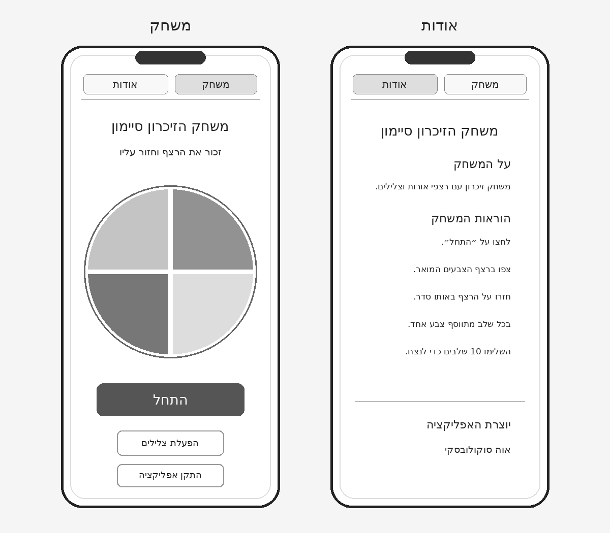
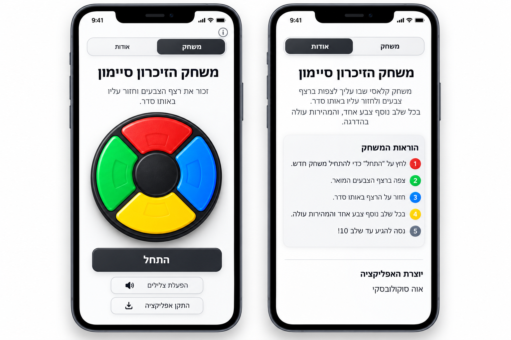
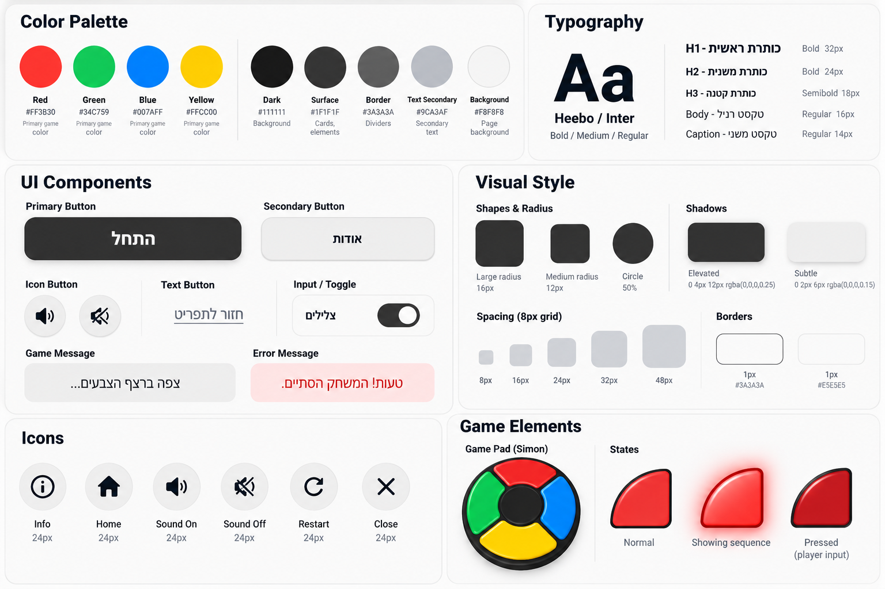

# DESIGN — משחק הזיכרון סיימון

מסמך זה מתאר את המימוש החזותי של שני מסכי האפליקציה. סדר העדיפויות במקרה של אי־התאמה: **PRD** להתנהגות ולתוכן מחייב, **Wireframes** למבנה ולרכיבים, **Style Guide** לשפה החזותית, ו־**Mockups** לאופן היישום החזותי. דוגמאות המופיעות בתמונות אך סותרות את ה־PRD אינן מוסיפות דרישות.

## 1. Screens – מסכי האפליקציה

### מקורות חזותיים למבנה ולמראה

**Wireframes — מבנה שני המסכים**

**Mockups — המראה החזותי של שני המסכים**

### 1.1 משחק

**מטרת המסך:** להציג את משחק הזיכרון ולאפשר התחלה, צפייה ברצף, שחזור הרצף והתקדמות בשלבים.

**מבנה ותוכן:**
- בחלק העליון תפריט אופקי דו־פריטי, מימין **״משחק״** (הפריט הפעיל) ומשמאל **״אודות״**, בתוך מסגרת מעוגלת; מתחתיו קו הפרדה עדין לפי ה־Wireframes.
- כותרת מרכזית ובולטת **״משחק הזיכרון סיימון״** והוראה קצרה **״זכור את רצף הצבעים וחזור עליו באותו סדר.״**
- במרכז המסך לוח משחק עגול גדול: אדום למעלה, כחול מימין, צהוב למטה, ירוק משמאל; ארבעה מקטעים מעוגלים סביב מרכז עגול כהה, עם הפרדות שחורות. הלוח הוא האלמנט החזותי הדומיננטי.
- מתחת ללוח כפתור Primary כהה ורחב **״התחל״** במצב הראשוני. במהלך המשחק אותו אזור פעולות מציג את ההודעות והפעולות המתאימות למצב: שלב נוכחי, **״תורך!״**, התקדמות הלחיצות, **״לשלב הבא״**, הודעת הפסד או ניצחון ו־**״שחק שוב״**; יש לשמור על היררכיית המסך ולא ליצור מסכים נוספים.
- מתחת לפעולה הראשית פקדים משניים: הפעלה/השתקה של צלילים, ו־**״התקן אפליקציה״** — ב־Android Chrome כאשר התקנה ישירה זמינה, וב־iPhone כאשר האפליקציה עדיין לא מותקנת (שם הלחיצה פותחת חלונית הסבר עם צעדי ההתקנה ב־Safari, מעל המסך הקיים, לא כמסך נפרד). בנוסף, **״משחק חדש״** זמין במהלך משחק פעיל, בהתאם ל־PRD. האישור על איפוס מופיע כ־Dialog מעל המסך הקיים, לא כמסך נפרד.

**פעולות וניווט:** התחלה, לחיצה על מקטעי הצבעים בתור השחקן, מעבר לשלב הבא, התחלת משחק חדש עם אישור כשנדרש, השתקה/הפעלה, התקנה (ישירה ב־Android, הסבר ב־iPhone), ומעבר ל־**״אודות״**. בעת הצגת הרצף המקטעים אינם לחיצים. הלוח מאיר להצגת הרצף, ולחיצת שחקן מפיקה צליל והתבהרות קצרה של הצבע כסימן ללחיצה, בהתאם ל־PRD.

### 1.2 אודות

**מטרת המסך:** לספק הסבר קצר על המשחק, הוראות ושם היוצרת.

**מבנה ותוכן:**
- אותו תפריט עליון, כאשר **״אודות״** מסומן כפעיל ו־**״משחק״** אינו פעיל.
- כותרת מרכזית **״משחק הזיכרון סיימון״**.
- אזור תוכן ב־RTL עם כותרת משנה **״על המשחק״** ופסקה קצרה המסבירה את עקרון הזיכרון באמצעות אורות וצלילים.
- כותרת משנה **״הוראות המשחק״** ורשימת הוראות קצרות, מיושרות לימין, המתארות התחלה, צפייה ברצף, שחזור והתקדמות עד שלב 10. ה־Mockup מדגים רשימה ממוספרת עם עיגולים צבעוניים; זהו עיצוב הרשימה ולא מנגנון משחק חדש.
- קו מפריד ולאחריו אזור **״יוצרת האפליקציה״** ושם היוצרת **״אוה סוקולובסקי״**.

**פעולות וניווט:** מעבר בחזרה ל־**״משחק״** דרך התפריט העליון. מצב המשחק נשמר בזיכרון ומושהה בזמן השהייה במסך זה, בהתאם ל־PRD.

### 1.3 ניווט כללי

שני המסכים משתמשים באותו תפריט עליון קבוע במבנהו, עם מצב פעיל ברור. ניווט הטקסט והסדר החזותי הם RTL. אין מסכי משנה נוספים; מצבי המשחק השונים וחלונית האישור מוצגים בתוך מסך **״משחק״**.

## 2. Style Guide – השפה העיצובית

### 2.1 Color Palette

| שימוש | צבע | HEX |
|---|---|---|
| מקטע אדום | Red | `#FF3B30` |
| מקטע ירוק | Green | `#34C759` |
| מקטע כחול | Blue | `#007AFF` |
| מקטע צהוב | Yellow | `#FFCC00` |
| צבע כהה ללוח, כותרות ופרטים מרכזיים | Dark | `#111111` |
| משטחי רכיבים | Surface | `#1F1F1F` |
| קווים והפרדות | Border | `#3A3A3A` |
| טקסט משני, לפי המקור | Text Secondary | `#9CA3AF` |
| רקע עמוד | Background | `#F8F8F8` |

הצבעים העזים מרוכזים בעיקר בלוח Simon ובנגיעות קטנות במידע המשני. יתר הממשק נשען על לבן, אפור ופחם. ה־Mockups מדגימים הצללות והברקות על המקטעים; קודי ה־HEX לעיל הם צבעי הבסיס, ולא תיאור מלא של כל Gradient או מצב הארה.

### 2.2 Typography

- **Font families:** `Heebo` לטקסט בעברית; `Inter` לטקסט לטיני ולמונחים באנגלית, עם Sans-serif כגיבוי.
- **H1:** ‏32px, Bold — שם המשחק.
- **H2:** ‏24px, Bold — כותרות אזורים כגון **״הוראות המשחק״**.
- **H3:** ‏18px, Semibold — כותרות משנה קטנות.
- **Body:** ‏16px, Regular — הוראות ופסקאות.
- **Caption:** ‏14px, Regular — תוויות וטקסט משני.
- הטקסט הראשי כהה על רקע בהיר. הכותרת הראשית ממורכזת; תוכן קריאה מפורט מיושר לימין. משקלים גדולים במיוחד נראים בכפתור הראשי ובכותרת המשחק ב־Mockups.

### 2.3 UI Style

- **Primary Button:** רקע פחם כהה, טקסט לבן מודגש, צורה מלבנית רחבה עם פינות מעוגלות (כ־16px) וצל עדין. משמש ל־**״התחל״** ולפעולה הראשית הרלוונטית.
- **Secondary Button:** רקע בהיר, מסגרת אפורה דקה, טקסט כהה, פינות מעוגלות; משמש לפעולות כגון **״הפעלת צלילים״** ו־**״התקן אפליקציה״**. הכפתורים המשניים ממורכזים ומופרדים במרווח אנכי.
- **Navigation:** שני פריטים ברוחב דומה בתוך מסגרת בהירה ומעוגלת; הפריט הפעיל כהה עם טקסט לבן והפריט הלא פעיל בהיר עם טקסט כהה. אין להוסיף אייקון מידע נפרד, משום שב־Wireframes הניווט הוא באמצעות שני פריטי תפריט.
- **Icons:** אייקונים פשוטים ומוכרים, בסגנון מלא/קו נקי, כ־24px, כגון Sound On, Sound Off ו־Install. צבע כהה על רקע בהיר.
- **Messages:** אזור הודעה ניטרלי ובהיר למצב משחק, וחיווי שגיאה בגוון אדום בהיר בהתאם ל־Style Guide. יש לשמור על הטקסטים שהוגדרו ב־PRD, כגון **״תורך!״** ו־**״המשחק נגמר״**.
- **Cards:** משטחים לבנים או אפורים בהירים, עם מסגרת/צל עדינים ופינות מעוגלות. ב־Mockup אזור הוראות המשחק מופיע ככרטיס קליל.
- **Input / Toggle:** ה־Style Guide מציג דוגמת Toggle, אך אין דרישה לשדה קלט במשחק. שליטת השמע תתממש ככפתור/מתג יחיד לפי הרכיב המתאים ל־Wireframes, ללא הוספת טופס.

### 2.4 Visual Style

- **אופי חזותי:** משחקי ונוסטלגי בהשראת Simon הפיזי, אך בתוך מעטפת Mobile מודרנית, נקייה ובהירה.
- **לוח המשחק:** ארבעה מקטעים בצורת קשת/רבע טבעת סביב עיגול מרכזי שחור. מעטפת כהה, הפרדה ברורה בין הצבעים, הברקות וצללים המדמים חומר פלסטי מבריק. לא להשתמש בתמונה שטוחה של הלוח במקום רכיבי לחיצה נפרדים.
- **Shapes & Radius:** עיגולים עבור לוח המשחק ואייקונים; פינות של כ־16px לרכיבים גדולים וכ־12px לרכיבים בינוניים, בהתאם ל־Style Guide.
- **Borders:** קו 1px עדין לרכיבים בהירים; מעטפת הלוח כהה ועבה יותר. ערכי הבסיס המופיעים במקור הם `#3A3A3A` ו־`#E5E5E5`.
- **Shadows:** צל מודגש לדוגמאות רכיבים מוגבהים (`0 4px 12px rgba(0,0,0,0.25)`) וצל עדין (`0 2px 6px rgba(0,0,0,0.15)`). יש להפעילם במתינות כדי לא להכביד על המסך.
- **Spacing:** מערכת מרווחים בכפולות 8px: ‏8, 16, 24, 32 ו־48px. מרווחים גדולים יותר בין אזורי תוכן ומרווחים קטנים יותר בתוך קבוצות פקדים.
- **Layout:** Mobile First; תוכן ממורכז לרוחב המסך, שוליים צדדיים עקביים, לוח המשחק כאלמנט המרכזי, כפתור פעולה ראשי רחב ופקדים משניים מתחתיו. גובה המסך אינו מחייב דחיסת תוכן; ניתן לגלול במכשירים קטנים.
- **Imagery:** אין צורך בתמונות תוכן או באיורים נוספים. לוח Simon הוא האלמנט הגרפי המרכזי; שאר הממשק מינימליסטי.

### 2.5 שפה וכיווניות

- כל תוכן הממשק בעברית בלבד, עם `dir="rtl"` ויישור ימני לפסקאות ולהוראות.
- כותרת המשחק והלוח ממורכזים, אף שהמסמך והממשק ב־RTL.
- סדר הניווט: **״משחק״** מימין ו־**״אודות״** משמאל; מצב פעיל משתנה לפי המסך.
- ערכים מספריים, יחידות CSS, קודי HEX ושמות טכנולוגיים מוצגים בכיווניות המתאימה לקריאותם, ללא שינוי סדר הספרות.

### 2.6 הבהרות עקב הבדלים בין המקורות

- ה־Mockup מציג כפתור התקנה בתוך הדמיית iPhone; לפי ה־PRD המעודכן, **ב־iPhone הכפתור מוצג** ופותח חלונית הסבר (אין התקנה ישירה). ב־Android Chrome הכפתור מוצג כאשר התקנה ישירה נתמכת.
- ב־Mockup של מסך **״אודות״** מצב הניווט הפעיל נראה לא עקבי; במימוש יש לסמן את **״אודות״** כפעיל.
- ב־Mockup מופיע גם אייקון מידע בפינה; ה־Wireframes וה־PRD מגדירים תפריט ניווט בן שני פריטים בלבד, ולכן אין להוסיף אותו.
- ה־Style Guide מדגים מצב `Pressed` עם שינוי חזותי במקטע, והוא מיושם כהתבהרות קצרה של המקטע בלחיצת שחקן; ההארה החזקה (עם זוהר) מיועדת להצגת הרצף בלבד.

המסמך מתאר את עיצוב הממשק בלבד. חוקי המשחק, מצבי המערכת והתנהגות PWA/Offline מפורטים ב־PRD וב־ARCHITECTURE.
